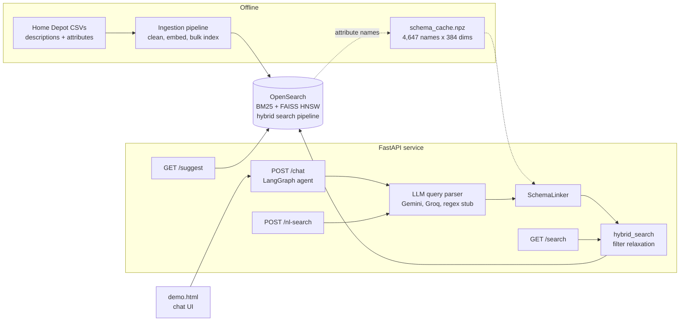
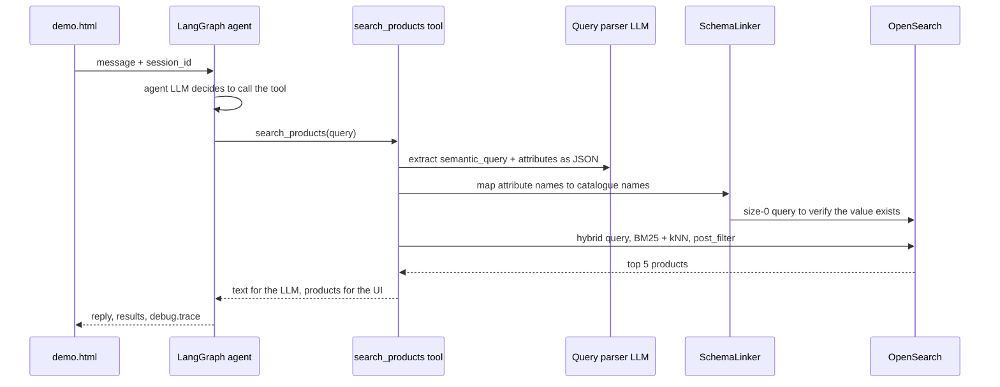
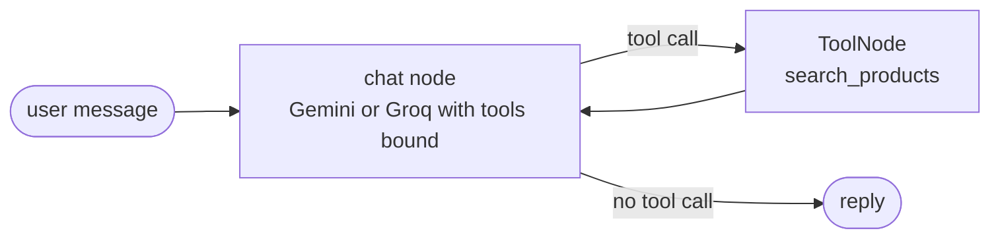

<div align="center">

# 🛠️ Agentic AI Product Discovery

**A conversational search assistant for a home-improvement catalogue. A LangGraph agent turns requests like *"12 gauge galvanized steel joist hanger"* into hybrid BM25 + vector queries over OpenSearch. Before filtering, a schema linker maps the shopper's wording onto the catalogue's 4,647 real attribute names.**

Research prototype for an M.Sc. thesis at Berliner Hochschule für Technik.


[What it does](#-what-it-does) · [Architecture](#-architecture) · [Quickstart](#-quickstart) · [API](#-api) · [Technical deep dive](#-technical-deep-dive) · [Design decisions](#-design-decisions) · [Limitations](#-known-limitations--roadmap)

</div>

---

## 🎯 What it does

A shopper says what they need in their own words and gets ranked products with their specs, in a chat. The hard part is the specs. People write "colour" or "8.5 inch deep", but the catalogue stores `Color/Finish` and `Assembled Depth (in.)` among 4,647 attribute names.

| # | Outcome | Powered by |
|---|---------|------------|
| 1 | Ask in plain language and get the 5 best-matching products with their specs | A LangGraph agent with one `search_products` tool ([`chatbot.py`](services/api/chatbot.py)) |
| 2 | Specs in the request become filters, even when worded differently from the catalogue | An LLM query parser plus a **SchemaLinker** that checks each match against the index ([`nl_query.py`](services/api/nl_query.py)) |
| 3 | Both exact terms ("12 gauge") and vague intent ("something to hang joists") find products | BM25 + 384-dim dense vectors, min-max normalised and blended 0.4 / 0.6 ([`search.py`](services/api/search.py)) |
| 4 | Over-specified requests still return results | Filters are dropped one at a time when they produce zero hits, with a lexical fallback if the hybrid query fails |
| 5 | Every answer shows how it was reached | A per-request trace (parsed intent, schema links with similarity scores, query shape, hits) returned with each reply and animated in the demo UI |

> [!IMPORTANT]
> This is a research prototype, not a production service. Chat sessions live in process memory, there is no authentication, and the agent is **search-only**: the cart and checkout flow from earlier versions has been removed.

---

## 🏗 Architecture

<p align="center">
  
</p>

<sub>Editable source: [`images/architecture.drawio`](images/architecture.drawio) (open in draw.io or diagrams.net).</sub>

<details>
<summary><b>Text version (Mermaid)</b></summary>



</details>

Ingestion runs offline. [`pipeline.py`](services/ingestion/pipeline.py) turns the Home Depot CSVs into an OpenSearch index, and [`build_schema_cache.py`](services/scripts/build_schema_cache.py) snapshots the index's attribute names with their embeddings. The FastAPI service ([`main.py`](services/api/main.py)) loads the embedding model and that cache at startup. It then serves four entry points that share one retrieval core. The agent and the query parser both try Gemini first and fall back to Groq.

A single chat turn:



---

## 🚀 Quickstart

### 1. Prerequisites

- **Python 3.10+**: LangChain 1.x and LangGraph 1.x require it. The project was developed on 3.13.
- **OpenSearch 2.10 or later** with the k-NN and neural-search plugins, which hybrid queries need. It was developed against Amazon OpenSearch Service; the official Docker image works for local runs.
- **An LLM key**: Google Gemini, Groq, or both. `/chat` needs at least one. `/search` needs neither, and `/nl-search` falls back to a regex parser without one.
- **The data**: `product_descriptions.csv` and `attributes.csv` from Kaggle's [Home Depot Product Search Relevance](https://www.kaggle.com/c/home-depot-product-search-relevance/data) competition, placed in `volumes/home_depot_data/` (git-ignored). The author's index uses the first 50,000 products (`product_uid` 100001–150000, about 600k attribute rows), saved as `*_50k.csv`. The full files work too, but take longer to embed.

### 2. Install

```bash
git clone https://github.com/aks861999/AGENTIC-AI-PRODUCT-DISCOVERY.git
cd AGENTIC-AI-PRODUCT-DISCOVERY

python -m venv .venv
source .venv/bin/activate                  # Windows: .venv\Scripts\activate

pip install -r services/api/requirements.txt
pip install -r services/ingestion/requirements.txt
```

> [!NOTE]
> Both requirements files pin `torch==2.6.0+cpu` from PyTorch's CPU wheel index, which has Linux and Windows builds. On macOS, change the pin to `torch==2.6.0`.

For a local OpenSearch (optional):

```bash
docker run -d --name opensearch -p 9200:9200 \
  -e "discovery.type=single-node" \
  -e "DISABLE_INSTALL_DEMO_CONFIG=true" -e "DISABLE_SECURITY_PLUGIN=true" \
  opensearchproject/opensearch:2.19.1
```

### 3. Configure

Copy [`.env.example`](.env.example) to `.env` and fill it in. The essentials:

```dotenv
# OpenSearch (local Docker shown; .env.example has an Amazon OpenSearch Service example).
# Leave OPENSEARCH_USER / OPENSEARCH_PASSWORD unset for a cluster without auth.
OPENSEARCH_HOST=localhost
OPENSEARCH_PORT=9200
OPENSEARCH_USE_SSL=false
OPENSEARCH_VERIFY_CERTS=false
INDEX_NAME=products

# Data, relative to the repo root
HOME_DEPOT_DESC_PATH=volumes/home_depot_data/product_descriptions_50k.csv
HOME_DEPOT_ATTR_PATH=volumes/home_depot_data/attributes_50k.csv

# LLMs: Gemini first, Groq as fallback
GOOGLE_API_KEY=your-gemini-key
LLM_MODEL=gemini-2.5-flash
GROQ_API_KEY=gsk_...
GROQ_MODEL=llama-3.3-70b-versatile
LLM_TEMPERATURE=0.0
MAX_RETRIES=0

# Embeddings + ingestion
EMBEDDING_MODEL=BAAI/bge-small-en-v1.5
BATCH_SIZE=128
CHUNK_SIZE=250
```

> [!WARNING]
> **Run every command from the repository root.** Settings are read from `.env` in the current working directory, and the data paths are relative to it. Running from `services/` silently ignores your `.env` and falls back to `localhost:9200` with no LLM keys.

<details>
<summary><b>Every setting the code reads</b> (from <a href="shared/config/settings.py"><code>shared/config/settings.py</code></a>)</summary>

<br/>

| Variable | Default | Effect |
|---|---|---|
| `OPENSEARCH_HOST`, `OPENSEARCH_PORT` | `localhost`, `9200` | Cluster address (API, ingestion, scripts) |
| `OPENSEARCH_USE_SSL`, `OPENSEARCH_VERIFY_CERTS` | `false`, `false` | TLS settings |
| `OPENSEARCH_USER`, `OPENSEARCH_PASSWORD` | unset | Basic auth, used only when the user is set |
| `INDEX_NAME` | `products` | Index (or alias) for ingestion, search and the schema cache |
| `EMBEDDING_MODEL` | `BAAI/bge-small-en-v1.5` | Sentence-transformers model for documents and queries; also sets the index's vector dimension |
| `BATCH_SIZE` | `128` | Encoding batch size during ingestion |
| `CHUNK_SIZE` | `500` (`250` in `.env.example`) | Documents per bulk request |
| `HOME_DEPOT_DESC_PATH`, `HOME_DEPOT_ATTR_PATH` | empty | Input CSVs for ingestion |
| `GOOGLE_API_KEY`, `LLM_MODEL` | unset, `gemini-2.0-flash` | Primary LLM for the parser and the agent |
| `GROQ_API_KEY`, `GROQ_MODEL` | unset, `llama-3.3-70b-versatile` | Fallback LLM over Groq's OpenAI-compatible API |
| `LLM_TEMPERATURE` | `0.0` | Query parser only; the agent is fixed at `0.3` |
| `MAX_RETRIES` | `0` | Gemini client retries; `0` lets a quota error fall through to Groq immediately |
| `LOG_LEVEL` | `INFO` | Log level for the API and ingestion |
| `DEFAULT_SIZE` | `10` | Results per page when `/search` or `/nl-search` doesn't set `size` |
| `KNN_K` | `500` | kNN candidates for hybrid and semantic search |
| `HYBRID_BM25_WEIGHT`, `HYBRID_KNN_WEIGHT` | `0.4`, `0.6` | Score weights in the hybrid search pipeline, scaled to sum to 1; written at ingestion and at every API startup |

</details>

### 4. Run

```bash
export PYTHONPATH=services                 # PowerShell: $env:PYTHONPATH = "services"

python -m ingestion                        # create index + hybrid pipeline, embed, bulk index
python -m scripts.build_schema_cache       # snapshot the index's attribute names for the SchemaLinker
uvicorn api.main:app --port 8000           # loads the model, warms the schema cache
```

Then open **http://localhost:8000/**: the API serves [`demo.html`](demo.html) at its root. Opening the file directly also works; it then calls `http://localhost:8000`.

The committed [`schema_cache.npz`](services/api/schema_cache.npz) was built from the author's 50k-product index. Rebuild it whenever you re-ingest, because the API always prefers the file on disk over the live index.

<details>
<summary><b>Re-indexing without downtime</b> (index aliases)</summary>

<br/>

Search through an alias (`INDEX_NAME=products`) and ingest into versioned indices behind it:

```bash
python -m ingestion --index products_v1
python -m ingestion.ensure_alias --create             # products -> products_v1
python -m ingestion --index products_v2               # rebuild while v1 keeps serving
python -m ingestion.ensure_alias --switch products_v2 # atomic switch
python -m ingestion.ensure_alias --delete-old         # drop products_v* not behind the alias
```

An alias can't share its name with a real index. If you first ingested straight into `products`, delete that index before running `--create`; the script stops with this hint otherwise.

</details>

Try it:

```bash
curl "http://localhost:8000/search?q=joist%20hanger&mode=hybrid&size=5"

curl -X POST http://localhost:8000/nl-search -H "Content-Type: application/json" \
  -d '{"query": "12 gauge galvanized steel joist hanger", "size": 5}'

curl -X POST http://localhost:8000/chat -H "Content-Type: application/json" \
  -d '{"message": "I need a galvanized joist hanger", "session_id": "demo-1"}'
```

Interactive API docs are at `http://localhost:8000/docs`.

---

## 📡 API

| Method | Endpoint | What it does |
|---|---|---|
| `GET` | `/` | The demo chat UI |
| `GET` | `/health` | Cluster health; `ok` when OpenSearch is green or yellow, otherwise `degraded` |
| `GET` | `/search` | `q`, `mode` (`lexical`, `semantic`, `hybrid`; default `hybrid`), `attributes` as a JSON string, `size` 1–100, `from` |
| `POST` | `/nl-search` | `{query, size}`: LLM parse, then schema linking, then hybrid search; returns hits plus `parsed_query` |
| `GET` | `/suggest` | `prefix`, `size` up to 20: title completions via `match_phrase_prefix` |
| `POST` | `/chat` | `{message, session_id}`: one agent turn; returns `reply`, up to 5 `results`, and `debug.trace` |
| `POST` | `/index/product` | Embed and index a single product, using the same embedding text as ingestion |

Every response carries `X-Process-Time-Ms` and `X-Correlation-ID` headers ([`middleware.py`](services/api/middleware.py)).

---

## 🔬 Technical deep dive

### 1. Ingestion: from EAV rows to search documents

The Kaggle catalogue is stored as entity–attribute–value rows: one description per `product_uid`, and specs as `(product_uid, name, value)` triples. That comes to about 600k rows for the 50,000-product subset. [`pipeline.py`](services/ingestion/pipeline.py) groups the rows per product, then:

- splits the `Bullet01…BulletNN` pseudo-attributes into `bullet_points`, in their original order, so `attributes` holds only real specs (including look-alikes such as `Bullet Proof`);
- appends bullets that aren't already in the description, and collapses whitespace;
- derives a `title`, which the dataset lacks, from `Bullet01`, falling back to the first 120 characters of the description;
- builds the embedding text from the description, the bullets and the `Name: Value` pairs, so specs match semantically as well as through filters.

Vectors come from `bge-small-en-v1.5`, L2-normalised and encoded in batches of 128. They are bulk-indexed in chunks of `CHUNK_SIZE` (250). During the load, the index's `refresh_interval` is set to `-1`. A `finally` block restores it to `1s`, and the index is then force-merged to one segment. `product_uid` is the document `_id`, so re-running ingestion overwrites documents instead of duplicating them. Content-hash deduplication was deliberately removed: the extra `mget` per batch cost about 100 ms and memory on a `t3.small` instance.

### 2. Index design

From [`schema.py`](services/ingestion/schema.py):

| Field | Mapping | Why |
|---|---|---|
| `title`, `product_description`, `bullet_points` | `text` with `product_analyzer` (standard tokenizer, lowercase, stop words, snowball stemmer) | So "clamps" matches "clamp" |
| `title.suggest` | Edge n-gram, 2–20 characters | Prefix matching |
| `attributes` | `nested`: `name` as `keyword`, `value` as `text` + `value.keyword` | Keeps each name bound to its own value. With a flat object array, `Material=Steel AND Color=White` could match a product whose material is white |
| `embedding_vector` | `knn_vector` sized from the model (384 for bge-small), FAISS HNSW, `innerproduct`, `m=8`, `ef_construction=64` | Vectors are unit-length, so inner product equals cosine similarity |

The mapping is `dynamic: strict`, with 1 shard and 0 replicas.

### 3. Query understanding

[`parse_nl_query`](services/api/nl_query.py#L586) asks an LLM for strict JSON: `{semantic_query, filters.attributes, search_mode}`. The prompt makes the model keep the shopper's exact attribute names and units ("Assembled Depth (in.)": "8.5 in"), and file features like "soft close" under `Features`. A tolerant extractor strips code fences and recovers the first `{…}` block.

- **Provider chain**: Gemini (`LLM_MODEL`), then Groq (`GROQ_MODEL`), then a regex **stub parser** that recognises patterns like `N gauge`, `N inch deep/wide/tall` and `galvanized/stainless steel`. Query parsing never hard-fails because of an LLM outage.
- **Schema hint** (on `/nl-search` and in the chat tool): the 20 catalogue attribute names closest to the query embedding are appended to the system prompt, so the LLM can use exact catalogue names from the start.

### 4. SchemaLinker: mapping the shopper's words to the catalogue's

This is the core idea, borrowed from schema linking in Text-to-SQL. The LLM outputs names like `colour` or `Brand`, while the index has 4,647 names such as `Color/Finish` and `MFG Brand Name`. A filter on the wrong name returns nothing. [`SchemaLinker.resolve`](services/api/nl_query.py#L292) tries, in order:

| Stage | Candidates | Accepted when |
|---|---|---|
| 1. Exact | Case-insensitive equality | The value is verified |
| 2. Substring | Extracted name (3+ characters) contained in a catalogue name, ranked by length ratio | The value is verified |
| 3. Embedding | Top 5 catalogue names with cosine ≥ **0.65** | The value is verified |
| 4. Fail-open | Keep the LLM's original name | Always |

Cosine similarity is a dot product, because every vector is normalised:

$$
\mathrm{sim}(q, c) = \mathbf{e}_q \cdot \mathbf{e}_c, \qquad \lVert \mathbf{e} \rVert = 1
$$

**Value verification** is what makes this safe. Before accepting a candidate name, the linker runs a `size: 0` nested query asking whether any product has that name with a value matching `match_phrase` (slop 2) or `fuzzy` (`AUTO`, prefix 1). It tries both the raw value and a unit-stripped one ("30 inches" becomes "30", "2 doors" becomes "2"). A name that merely sounds right but never carries the value is rejected. Verification fails open on errors, because an unverified guess guarantees zero results, while the original name might still match. All attributes in a query are resolved concurrently, and each result records its stage (and similarity score), which the chat trace displays.

**Cache**: the 4,647 names and their 384-dim `float32` embeddings are precomputed in [`schema_cache.npz`](services/api/schema_cache.npz) (6.7 MB) and loaded at startup. Without the file, the linker runs a nested `terms` aggregation (up to 5,000 buckets) and embeds every name, re-checking every 10 minutes.

### 5. Hybrid retrieval with graceful relaxation

[`hybrid_search`](services/api/search.py#L176) sends one OpenSearch `hybrid` query with two sub-queries:

- **BM25**: `multi_match` over `title^3` and `product_description^2` (`best_fields`, tie-breaker 0.3), plus a nested `should` over attribute names and values;
- **kNN**: `k = KNN_K` (500 by default) over `embedding_vector`.

The search pipeline `hybrid-search-pipeline` min-max normalises each sub-query's scores and combines them with a weighted arithmetic mean. Ingestion writes it, and the API rewrites it at every startup from `HYBRID_BM25_WEIGHT` / `HYBRID_KNN_WEIGHT`, so changing the weights needs only a restart. With the defaults:

$$
s(d) = 0.4 \cdot \hat{s}_{\mathrm{BM25}}(d) + 0.6 \cdot \hat{s}_{\mathrm{kNN}}(d), \qquad \hat{s} = \frac{s - s_{\min}}{s_{\max} - s_{\min}}
$$

Attribute filters go into a **`post_filter`**, not into the kNN clause. Each filter is a nested clause: a case-insensitive term on the name, and the value matched as an exact keyword, a phrase, or a fuzzy keyword. Applying filters after retrieval leaves scoring untouched and searches the full vector space instead of starving the ANN candidate pool.

Two safety nets keep the shopper from a dead end:

1. **Filter relaxation**: if a filtered query returns zero hits, the most recently added attribute (treated as the least certain) is dropped and the query is retried, until there are hits or no filters left.
2. **Lexical fallback**: if the hybrid query itself fails, for example because the pipeline is missing, the same request runs as plain BM25.

`/search` also exposes the single-mode queries: `lexical` (BM25 with `fuzziness: AUTO`) and `semantic` (kNN with `k = KNN_K` and filters inside the kNN clause).

### 6. The agent and its trace



[`chatbot.py`](services/api/chatbot.py) builds a two-node LangGraph `StateGraph`. The system prompt makes the model call `search_products` for any product need, and small talk is answered without a search. The tool returns JSON with two parts:

- `text`, which the LLM phrases into a reply;
- `products`, the top 5 hits trimmed to a 150-character description, 2 bullets and 5 attributes, which go straight to the UI as `results`. The LLM never has to reproduce product data.

Each step appends `{msg, type, ts}` to a per-request list held in a `ContextVar`. That way, concurrent async requests never mix traces. The list is returned as `debug.trace`, and the demo animates it into a collapsible "Reasoned for N s" block.

### 7. Serving

At startup, the FastAPI lifespan builds one OpenSearch client (60 s timeout, 3 retries, pool of 10), writes the search pipeline's weights, loads the embedding model in a worker thread, and warms the SchemaLinker. Every blocking call (encoding, OpenSearch requests) runs through `asyncio.to_thread`, so the event loop stays free. The dependency providers in [`dependencies.py`](services/api/dependencies.py) return `503` until the model and client are ready.

---

## 🧠 Design decisions

| Decision | Why |
|---|---|
| Hybrid BM25 + dense retrieval | Product queries mix exact tokens (model numbers, "12 gauge") that BM25 handles well with descriptive intent that embeddings handle well |
| Min-max normalisation before blending | BM25 scores are unbounded, while inner-product scores are bounded; they must share a scale before they can be mixed |
| Nested `attributes` mapping | Keeps each `name: value` pair together, so multi-attribute filters can't cross-match |
| Filters in `post_filter`, kNN unfiltered (`k = 500` by default) | Restrictive nested filters inside ANN would shrink the candidate pool; filtering afterwards keeps recall and leaves scores unchanged |
| Schema linking with value verification | Embedding similarity alone picks plausible but empty attribute names; checking the index makes sure a filter can actually match |
| Fail-open everywhere (linker, verification, LLM chain) | An unverified guess or a hard error guarantees zero results; the original input still has a chance |
| Relax filters on zero hits | Over-specified requests degrade to "closest available" instead of "nothing found" |
| Gemini, then Groq, then regex stub | Gemini quota exhaustion shouldn't take search down; `MAX_RETRIES=0` makes the switch immediate |
| Precomputed schema cache on disk | Skips a 5,000-bucket aggregation and embedding thousands of names on every startup |
| `bge-small-en-v1.5` (384 dims) on CPU torch | Small enough to embed 50k products and serve queries without a GPU |
| `product_uid` as `_id`, refresh off, force-merge | Idempotent re-ingestion, faster bulk loads, and a compact index for querying |
| Single-tool agent, graph compiled per request | The agent's only decision is whether to search or answer directly; compiling is cheap and keeps requests stateless apart from the session store |
| Per-request trace in a `ContextVar` | Makes every answer explainable in the UI without shared mutable state between concurrent requests |

---

## 📊 A real run

These outputs come from running the repo's own code offline, with no OpenSearch or LLM involved.

**Embedding stage of the SchemaLinker**, from `python -m scripts.test_schema_resolution` against the committed cache (trimmed):

```text
Resolving: 'Color'  (value='Moth Gray')
Rank  Score    Attribute Name
1     1.0000 ✓  Color
2     0.9493 ✓  Colored
3     0.8777 ✓  Color/Shade
4     0.8736 ✓  Light Color
5     0.8494 ✓  Color/Pattern
6     0.8461 ✓  Color/Finish ← TARGET
7     0.8413 ✓  Color or Black and White
...
10    0.8200 ✓  Front Color
```

All ten candidates clear the 0.65 threshold, and the right one ranks sixth. Similarity alone can't pick it, which is why each candidate must also prove that it carries the value "Moth Gray" in the index before it's accepted.

**Stub parser**, the last-resort fallback when no LLM is reachable ([`_stub_parse`](services/api/nl_query.py#L524)):

```text
"12 gauge galvanized steel joist hanger" -> semantic="joist hanger" attrs={"Gauge": "12", "Material": "Galvanized Steel"}
"8.5 inch deep pipe clamp"               -> semantic="pipe clamp"   attrs={"Assembled Depth (in.)": "8.5 in"}
"1-1/2 inch wide strap"                  -> semantic="strap"        attrs={"Assembled Width (in.)": "1-1/2 in"}
```

**Unit stripping** used during value verification ([`_normalize_attr_value`](services/api/nl_query.py#L78)):

```text
"30 inches" -> "30"    "2 doors" -> "2"    "8.5 in" -> "8.5"    "Frost Free" -> "Frost Free"
```

---

## 📁 Project structure

```
.
├── demo.html                         # single-file chat UI: reasoning trace, dataset viewer, mobile layout
├── .env.example                      # configuration template
├── images/                           # architecture.png + its editable draw.io source
├── shared/config/settings.py         # pydantic-settings: every env var with typed defaults
└── services/
    ├── api/                          # FastAPI service
    │   ├── main.py                   # routes and lifespan (client, model, cache warm-up)
    │   ├── chatbot.py                # LangGraph agent, search_products tool, request trace
    │   ├── nl_query.py               # LLM query parser, SchemaLinker, stub parser
    │   ├── search.py                 # lexical, semantic and hybrid queries; filter relaxation
    │   ├── models.py                 # Pydantic request and response models
    │   ├── dependencies.py           # shared client and model, 503 until ready
    │   ├── middleware.py             # timing and correlation-ID headers
    │   └── schema_cache.npz          # 4,647 attribute names + embeddings
    ├── ingestion/                    # CSV to OpenSearch ETL (python -m ingestion)
    │   ├── pipeline.py               # merge, clean, embed, bulk index
    │   ├── schema.py                 # index mapping + hybrid search pipeline
    │   └── ensure_alias.py           # alias create, switch, clean-up for re-indexing
    └── scripts/
        ├── build_schema_cache.py     # rebuild schema_cache.npz from the live index
        └── test_schema_resolution.py # inspect embedding matches for an attribute name
```

---

## 🧰 Tech stack

| Layer | Tools |
|---|---|
| API | FastAPI 0.136, Uvicorn, Pydantic v2, pydantic-settings |
| Agent | LangGraph 1.1 (`StateGraph`, `ToolNode`), LangChain 1.2 |
| LLMs | Google Gemini via `langchain-google-genai`; Groq (`llama-3.3-70b-versatile`) via `langchain-openai` |
| Retrieval | OpenSearch 2.x: BM25, k-NN plugin (FAISS HNSW), hybrid query + normalization processor |
| Embeddings | sentence-transformers 3.4, `BAAI/bge-small-en-v1.5`, PyTorch 2.6 (CPU) |
| Ingestion | pandas, `opensearch-py` bulk helpers |
| Frontend | One HTML file with vanilla JavaScript |

---

## 🧭 Known limitations & roadmap

**Known gaps in the current code**

- [ ] **No tests or CI.** `test_schema_resolution.py` is a diagnostic script, not a test suite.
- [ ] **No relevance evaluation yet.** The Kaggle dataset ships human query–product relevance labels, which would give NDCG figures for each search mode.
- [ ] **Schema cache never refreshes while the file exists.** After re-indexing, rebuild `schema_cache.npz`; an automatic check against the live index's attribute count would remove this manual step.
- [ ] **Not production-hardened.** Sessions are held in an unbounded in-memory dict, there's no auth or rate limiting, and CORS is `*`.

**Research roadmap** (planned for the thesis, not implemented)

- [ ] **Multimodal queries**: accept image + text input, with CLIP-style joint embeddings fused into the BM25/dense pipeline.
- [ ] **Implicit signal capture**: log the agent's tool calls as a structured event stream, and use session-level behaviour to re-rank results within the conversation.
- [ ] **Benchmark evaluation**: Amazon ESCI (~130k queries, NDCG) and SQID (~9k multimodal queries) for retrieval quality.

---

<div align="center">

Licensed under the [GNU GPL v2](LICENSE). The product data comes from Kaggle's Home Depot Product Search Relevance competition and is subject to its rules; it is not included in this repository.

</div>
